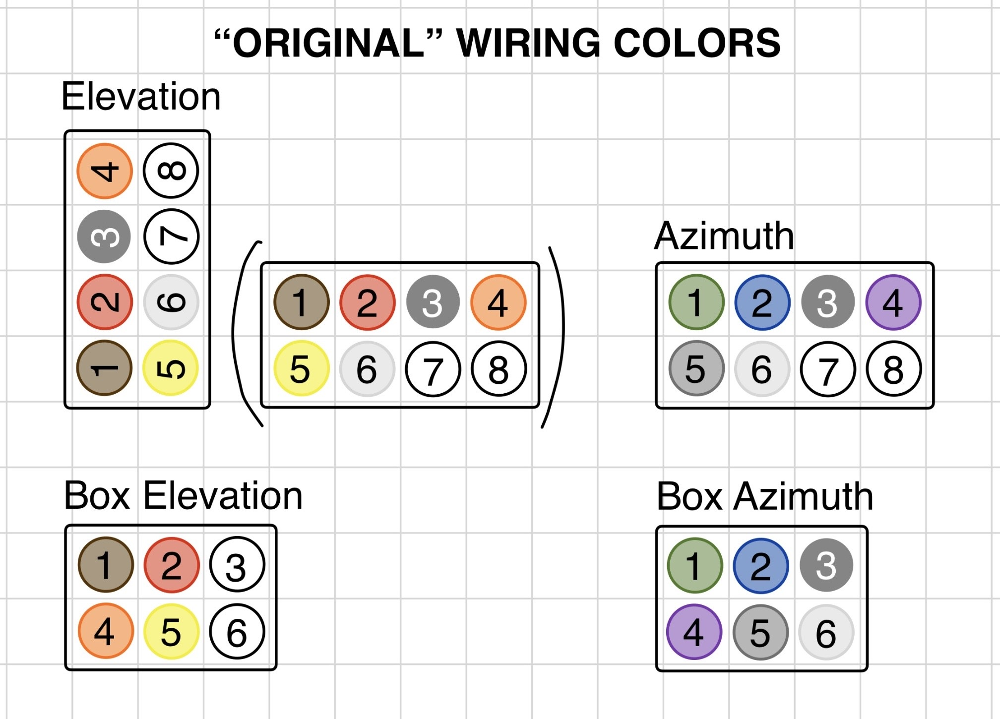
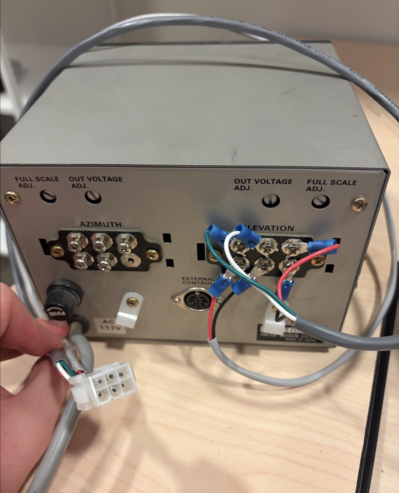

# 🛰️ November 21 Session Summary

```unset
mdate: 2026-11-21 19:30
tags:
  - CubeSat
  - RLGS
  - Logbook
  ```

**━━━━━━ . °‧ 𓆝  𝙻𝚘𝚐𝚋𝚘𝚘𝚔   °‧ 𓆝 𓆟 𓆞 ·。**

**Project:** Open Orbit RLGS / GSN — Gen 1.5 (Kenpro Integration)  
**Subsystem:** Gen 1.5 Kenpro / Yaesu G-5400B Teardown & Elevation control box Harness Assembly  
**Date:** November 21  
**Time / Finish** 2:00PM to 8:00PM  
**Lead:** Ryan H.    

**Objective:** Stripping out the legacy shared-ground harness on the Gen 1.5 Kenpro G-5400B rotator and control box, documenting the original wiring layout, and fabricating the new isolated Elevation control box cable with fork terminals and a 6-pin Molex connector.

#### **1. Version & Subsystem Scope Tracking**

**GitHub Repository (`open-orbit-rlgs` / `docs/`):** **Unchanged (Logbook Entry Prepared)**
* Established documentation rule keeping the legacy pre-teardown wiring chart strictly inside this chronological logbook (`docs/logbook/`) rather than living reference docs (`README.md` / `docs/wiring.md`) to prevent future wiring confusion.

**Python Controller (`positioner/control-software/`):** **v1.2.1 (Unchanged)**
* Existing FSM, degree tracking, and serial pipeline preserved.

**Arduino Firmware (`positioner/firmware/uno_halfstep/`):** **v1.0.0 (Unchanged)**
* Existing 8-state half-step sequence (`115200` baud) locked for Gen R1; planned `kenpro_din/` firmware held until Gen 1.5 bench wiring passes multimeter verification.

**Rotator Hardware (Gen R1):** **Unchanged**
* Dual 28BYJ-48 motors, balsa/bracket frame, direct 5.0V / 3.0A rail, calibrated Elevation limits (`-46.0°` to `+51.0°`).

**Rotator Hardware (Gen 1.5 — Kenpro / Yaesu G-5400B):** **Legacy Harness Removed & `EL` Control Box Side Assembled**
* Stripped all legacy wiring and screws from both rotator terminal blocks and both control box terminal blocks.
* Built and terminated the 6-conductor **Elevation (`EL`) control box harness** (blue `16–14 AWG` fork terminals landed on Terminals `1–6` + 6-pin Female Molex receptacle seated).

#### **2. Legacy Harness Teardown & Hardware Findings**

**Full Teardown & Pre-Removal Audit:**
* Unplugged `117V AC` mains and completely stripped the legacy wiring off both the rotator (`AZ` and `EL` blocks) and the rear control box (`AZIMUTH` and `ELEVATION` blocks), removing the undersized DE-15 splice, loose bare-clamped wires, and frayed braided/blue aluminized Mylar foil shielding.
* Documented the original pre-teardown wire colors and terminal assignments before removal:



**Hardware Anomalies Discovered During Teardown:**
* **Missing Control Box `EL` Terminal 6 Screw:** Discovered the screw for **Terminal 6** on the rear `ELEVATION` barrier block was missing, and confirmed that the spare screws in **Terminals 7 and 8** are a different thread size. Temporarily borrowed the matching screw from unused `AZIMUTH` Terminal 6 to complete the Elevation block (need to source 2 replacement metric machine screws for `AZ` Terminal 6 and a spare).
* **Single-Axis Isolation Verification:** Confirmed the G-5400B Azimuth and Elevation circuits are electrically independent inside the controller, allowing Elevation to be wired and bench-tested solo while Azimuth remains disconnected.

> **[INSERT PHOTO: Stripped Rotator & Control Box Terminal Blocks (Before/After)]**
> *(e.g., ``)*

#### **3. Elevation Control Box Harness Fabrication & Tooling Notes**

**Standardized 1-to-6 Elevation Pinout (`EL` Control Box Side):**
* Landed the `18 AWG` **4-wire** (`Red, Black, Green, White`, foil shield and bare drain wire trimmed flush at the jacket) and **2-wire** (`Red, Black`) bundles onto control box `ELEVATION` Terminals `1–6`:

| Terminal & Molex Pin | Cable Bundle | Wire Color | Function |
| :--- | :--- | :--- | :--- |
| **1** | 4-Wire | **Green** | Potentiometer Low (GND) |
| **2** | 4-Wire | **White** | Potentiometer Wiper (`0–5V` Sense) |
| **3** | 4-Wire | **Red** | Potentiometer High (`+Ref`) |
| **4** | 2-Wire | **Red** | Motor Phase 1 (`Down`) |
| **5** | 2-Wire | **Black** | Motor Phase 2 (`Up`) |
| **6** | 4-Wire | **Black** | Motor Common (Return) |

**Crimping & Connector Assembly Lessons:**
* **Two-Stage Fork Terminal Crimping:** Identified that the lab's `HSC8 6-4` square crimper is strictly for uninsulated bootlace ferrules, while the `MulWark` stripper/crimper's colored oval cavities are sized for larger insulated barrels (`16–14 AWG`). Achieved clean, tug-tested cold-weld crimps on unfolded `18 AWG` copper inside blue `16–14 AWG` fork terminals using a two-stage squeeze (shaping the sleeve in the top oval cavity, then dimpling the center barrel in the upper uninsulated cavities).
* **Molex Orientation & Gauge Fit:** Assigned the **6-pin Female Molex receptacle** to the control box side so live `24V AC` motor drive contacts remain recessed inside insulated cavities when unplugged. Seated all 6 crimped `18 AWG` conductors into the `20 AWG`-rated Molex pins and locked them into the `3×2` housing.



#### **4. Immediate Next Steps (Next Session)**

1. Pick up additional blue `16–14 AWG` fork terminals (plus 2 matching replacement screws for control box `AZ` Terminal 6 and a spare) and grab a ratcheting insulated terminal crimper if available.
2. Fabricate the mating **Elevation rotator-side harness** (~4 ft `18 AWG` 4-wire + 2-wire bundles, 6 fork terminals on rotator `EL` Terminals `1–6`, and the **6-pin Male Molex plug** mirrored `1-to-1` to the control box receptacle).
3. With `117V AC` mains unplugged and the Elevation Molex mated, verify resistance at the control box with a multimeter (`~500 Ω` across Pins `1–3`, `~10–30 Ω` across Pins `4–6`, and `OL` between motor and potentiometer circuits).
4. Power on the control box for an Elevation bench slew test (`DOWN` / `UP`) and calibrate the front meter and `OUT VOLTAGE ADJ.` (`0–5V`) trim pot, then repeat harness assembly for Azimuth.
